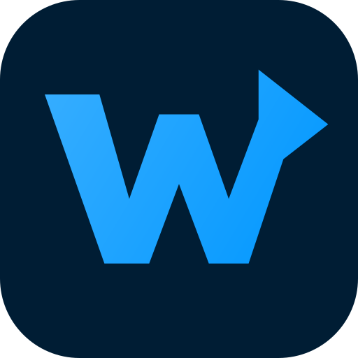
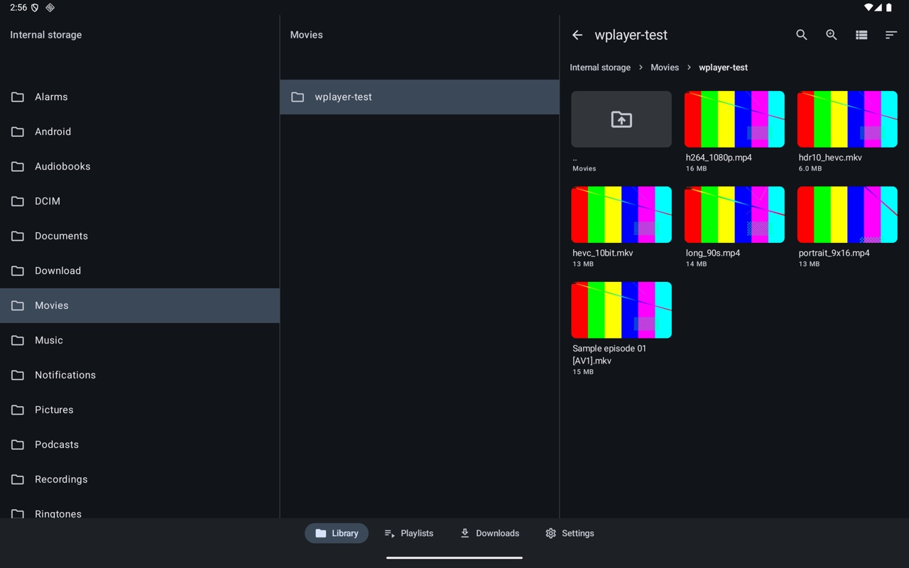
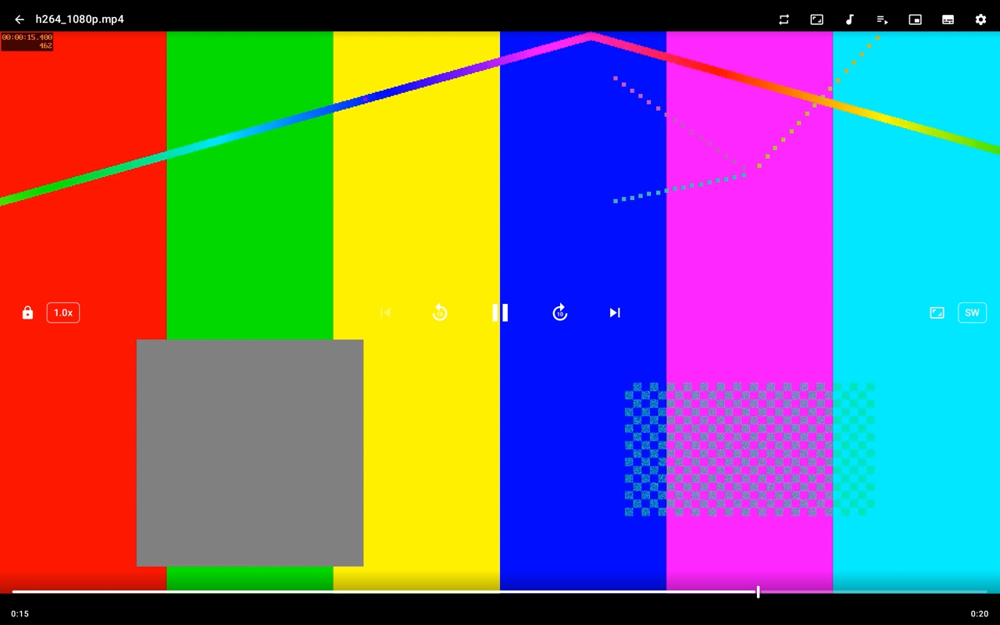
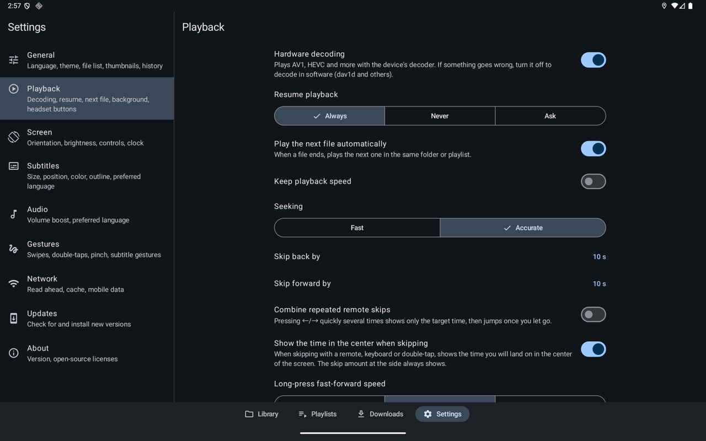
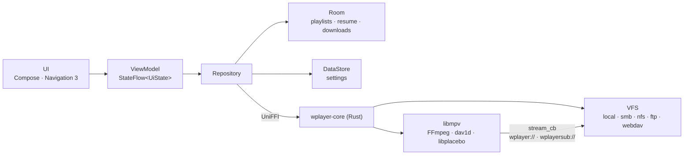

<div align="center">



# Wplayer

**A video player for Android tablets, phones and TVs that plays straight from your file servers**

[](https://github.com/rapidrabbit76/Wplayer/actions/workflows/ci.yml)


[](LICENSE)

English · [한국어](docs/translations/README.ko.md)

</div>

Wplayer browses SMB, NFS, FTP and WebDAV shares and your device's storage, and plays what it finds with
[libmpv](https://mpv.io) and FFmpeg: hardware decoding with a software fallback, every subtitle format mpv
knows, and gesture controls tuned for large screens. Network access, thumbnails and downloads go through
a Rust core, so browsing and playback share one connection layer.

<p align="center">
  
</p>
<table>
  <tr>
    <td width="50%"></td>
    <td width="50%"></td>
  </tr>
  <tr>
    <td align="center"><sub>Player: quick menus, 10-second skips, frame previews on the seek bar</sub></td>
    <td align="center"><sub>Settings: categories beside their options on wide screens</sub></td>
  </tr>
</table>

## Highlights

| | |
|---|---|
| 🎞️ **Codecs** | Hardware decoding of H.264, HEVC, AV1, VP9 and more; software decoding (dav1d for AV1) when the chip can't |
| 🗄️ **Sources** | Device storage · SMB 2/3 · NFSv3 · FTP/FTPS · WebDAV(S) |
| 👆 **Gestures** | Swipes for brightness, volume and seeking; double-taps; long-press fast-forward; drag and pinch subtitles |
| 📶 **Streaming** | Read-ahead up to 300 s and a disk cache up to 10 GB |
| 🖼️ **Thumbnails** | Video thumbnails over every protocol and codec, frame previews while seeking |
| 🤖 **AI subtitles** | On-device speech recognition (whisper.cpp) that writes subtitles as you watch |
| ⬇️ **Downloads** | Save files from a server; resumes after Wi-Fi drops or app restarts |
| 🎧 **Background** | Audio-only playback with the screen off, headset buttons, lock-screen controls |
| 📺 **TV** | Android TV / Google TV launcher, full D-pad navigation, remote-control playback |
| 🌐 **Languages** | English and Korean, following the system or chosen in Settings |

## Features

<details open>
<summary><b>Playback engine</b></summary>

- **libmpv 0.41, FFmpeg 9.0.2 and dav1d 1.5.4**, built from source by [`native/build.sh`](native/build.sh)
- **Hardware decoding** of H.264/HEVC/AV1/VP9/VP8/MPEG-2/MPEG-4 through MediaCodec (zero-copy output), falling
  back to `mediacodec-copy` and then software. Codecs the chip lacks play in software automatically; if the
  hardware decoder produces no frame within 10 seconds, playback continues on the software engine.
- **Output** through `vo=gpu-next` (libplacebo); HDR is tone-mapped to the SDR display.
- **Upscaling enhancement** (Settings → Screen, applies when the video is scaled up): GPU shaders for sharp
  (AMD FSR 1), detail (FSRCNNX x2) or anime (Anime4K mode A) output, plus debanding and frame blending matched
  to the display's refresh rate (`display-resample` + `interpolation`).
- **AI subtitles** (subtitle menu in the player): whisper.cpp transcribes the audio on the device into SRT,
  starting where you are watching. A separate mpv decodes only the audio at 16 kHz, and Silero VAD keeps the
  timestamps on speech. Models (small, 264 MB, or large-v3-turbo, 574 MB) download over Wi-Fi from
  Settings → Subtitles and are checked against their SHA-256. Nothing leaves the device.
- **Playback stats** overlay (developer option): codec, decoder, dropped frames, bitrate, cache.

</details>

<details open>
<summary><b>Controls</b></summary>

- Previous/next within a folder or playlist, auto-play next, repeat (one/all), shuffle
- Resume (always/never/ask), A-B repeat, speed (optionally kept), audio delay, volume boost up to 200%
- Aspect ratio, fit/stretch/fill, hardware ↔ software decoding, picture-in-picture, screen lock
- Dragging the seek bar or swiping sideways previews **the frame at that position**
- Quick menus beside the play button: lock · speed · scaling and aspect · decoder
- The ⚙ button changes playback, screen, subtitle, audio and gesture settings without leaving the video
- **Bluetooth remotes and keyboards**: tap ←/→ to skip, hold → for the next file and ← to restart (or the
  previous file near the start); Space/Enter/media keys play and pause; brightness keys set the player's brightness
- **TV remotes**: ↑/↓ or Menu focus the controls; the D-pad moves between them and ←/→ on the seek bar seeks.
  Panels take focus when opened; Back closes a panel, then hides the controls, then leaves the player.

</details>

<details open>
<summary><b>Gestures</b></summary>

| Gesture | Action |
|---|---|
| Vertical swipe on the left / right | Brightness / volume |
| Horizontal swipe | Seek (with frame preview) |
| Double-tap the sides / center | Skip ±N seconds / picture-in-picture (or play-pause) |
| Long press | Fast-forward |
| Pinch | Zoom |
| Two fingers ↓ / ↔ | Picture-in-picture / subtitle delay |
| Drag · pinch · swipe on a subtitle | Move it · resize it · previous/next line |

</details>

<details open>
<summary><b>Subtitles</b></summary>

- ASS/SRT/SMI; external subtitles with the same name load automatically; legacy encodings such as CP949
  are detected and converted to UTF-8
- Size, position, color, outline, shadow, background box and preferred language
- In-player subtitle panel for delay, size and position

</details>

<details open>
<summary><b>Browsing and library</b></summary>

- Tabs for Library · Playlists · Downloads · Settings (a navigation rail on TVs)
- **Continue watching** on the library's first screen, watch-progress bars, sorting and filters
- **Locked folders**: long-press a folder to lock it behind the device's fingerprint, face or screen lock.
  It locks again when you leave the app, and its videos stay out of history, search results and the thumbnail cache.
- Folders opened before show instantly and refresh in the background
- **Column view** of parent folders on wide screens, list ↔ grid in every list, adjustable thumbnail size
- **Name search** in the current folder as you type, or across subfolders (10 levels, 500 results), answered
  from a file-name index (Room) and refreshed in the background. Once a day, while charging on Wi-Fi, the
  index can be built ahead.
- A **path bar** and a **`..` parent row** for deep folders (either or both)
- **Playlists** of files and folders; folders open like bookmarks. Recently played history.
- Themes: dark by default, wallpaper colors, pure black

</details>

<details open>
<summary><b>Network, downloads and background playback</b></summary>

- **Network cache**: read-ahead (up to 300 s), cache size (up to 10 GB, in storage rather than memory),
  resume-after-buffering, mobile data on or off. Local files are not cached.
- **Thumbnails**: a short-lived mpv (`vo=image`) writes one frame as JPEG, so they work for every protocol and codec
- **Downloads**: WorkManager jobs with progress notifications, saved to `Download/Wplayer`, resumed after
  network drops or restarts
- **Background playback**: a Media3 `MediaSession` (a `SimpleBasePlayer` wrapping mpv) in a
  `MediaSessionService`, with notification and lock-screen controls, headset and Bluetooth buttons, audio focus,
  and pause on unplugging headphones. Video decoding stops while nothing is visible.

</details>

## Install

Download the APK from the [latest release](https://github.com/rapidrabbit76/Wplayer/releases/latest) and open it
on the device (allow "Install unknown apps" for your browser or file manager). The app checks GitHub for new
releases (at start-up, at most every 12 hours, or from Settings → Updates), verifies the download's SHA-256 and
hands it to the system installer.

On a TV, install the APK once with `adb install` or a sideloading app; updates then arrive the same way.
One APK covers 64-bit ARM (`arm64-v8a`) and 32-bit ARM (`armeabi-v7a`), the latter for TVs that run a 32-bit system.

### Connecting to a server

| Protocol | Path | Notes |
|---|---|---|
| SMB | Empty for the list of shares, or `/share[/folder]` | SMB 2/3 (including required encryption), port 445. Guest (anonymous) login is not supported yet; use an account. |
| NFS | The export path (`/volume1/video`) | Put `uid` or `uid:gid` in the user name. Apps cannot use ports below 1024, so allow connections from non-privileged ports ("insecure") on the server. |
| FTP / FTPS | The start folder | FTPS uses explicit TLS (`AUTH TLS`). Data connections go to the server you connected to rather than the address in the PASV reply, which helps behind NAT and in containers. |
| WebDAV(S) | The WebDAV base path | Synology uses ports 5005/5006. Turn on "Allow self-signed certificates" for servers with their default certificate. |

Passwords are encrypted with the Android Keystore (AES-GCM) before they are stored.

## Build

Requirements:

- JDK 21, the Android SDK (platform 37) and NDK `30.0.16248370`
- Rust (stable) with `cargo-ndk` and the targets `aarch64-linux-android` and `armv7-linux-androideabi`
- For the native libraries: `meson`, `ninja`, `cmake`, `nasm`, `pkg-config` and `git`; `libclang` for bindgen

On macOS with Homebrew: `brew install openjdk@21 android-commandlinetools meson ninja cmake nasm pkg-config`.
On Ubuntu, see the packages in [the CI workflow](.github/workflows/ci.yml).

```sh
source ./env.sh                       # JAVA_HOME, ANDROID_HOME, ANDROID_NDK_HOME (edit or override for your setup)
native/build.sh                       # libmpv, FFmpeg and friends for both ABIs; once, takes several minutes
./gradlew :app:assembleDebug          # cross-compiles the Rust core and generates its Kotlin bindings
```

To update a native library, change its version in [`native/versions.env`](native/versions.env) and rebuild it
(`native/build.sh ffmpeg mpv`).

**Release builds** are signed with the key described in `keystore.properties` at the repository root (never
committed); without it they fall back to the debug key, and such an APK cannot update an install signed with
the release key.

```properties
storeFile=/path/to/release.jks
storePassword=…
keyAlias=…
keyPassword=…
```

A fork that publishes its own releases sets `wplayer.updateRepository=owner/repo` in `gradle.properties` so its
installs look for updates there.

After large UI changes, regenerate the Baseline Profile (needs a connected device or emulator, about 5 minutes);
it precompiles the start-up and scrolling paths:

```sh
./gradlew :app:generateReleaseBaselineProfile   # → app/src/release/generated/baselineProfiles/
```

## Architecture



```
app/              UI (Compose, Navigation 3, Material 3 Adaptive), ViewModels, Room/DataStore, Hilt, WorkManager, Media3
core/native/      The Kotlin ↔ native boundary: generated UniFFI bindings, MpvEngine, Surface JNI
rust/             wplayer-core: protocols (VFS), libmpv bridge, thumbnails and frame previews, downloads,
                  subtitle encoding, speech recognition
native/           Build script for libmpv, FFmpeg, dav1d, libass, libplacebo (versions pinned in versions.env)
baselineprofile/  Baseline Profile generator (start-up, browsing, settings)
scripts/          Release script and local FTP/WebDAV/SMB/NFS test servers
```

- Screens follow unidirectional data flow: ViewModels expose `StateFlow<UiState>`, screens send events up.
- Network files are read by Rust and handed to mpv through `stream_cb`, so browsing and playback share one path.

## Test

```sh
(cd rust && cargo test)                                    # Rust unit tests
./gradlew :app:testDebugUnitTest :core:native:testDebugUnitTest :app:lintRelease
./gradlew :app:recordRoborazziDebug                        # phone and tablet screenshots → app/build/outputs/roborazzi
eval "$(scripts/test-servers.sh start)"                    # local FTP, WebDAV, SMB (Docker) and NFS servers
(cd rust && cargo test -p wplayer-core --test live_sources -- --ignored)
scripts/test-servers.sh stop
```

Lint warnings fail the build; suppress one only with a reason in [`app/lint.xml`](app/lint.xml).

<details>
<summary><b>Emulators</b></summary>

```sh
avdmanager create avd -n wplayer_tablet -k "system-images;android-36;google_apis;arm64-v8a"
# config.ini: hw.lcd.width=2560, hw.lcd.height=1600, hw.lcd.density=280,
#             kernel.parameters=arm64.nosve arm64.nosme   ← the emulator misreports SVE and dav1d dies with SIGILL
$ANDROID_HOME/emulator/emulator -avd wplayer_tablet
```

- The emulator's MediaCodec (goldfish) never outputs a first frame, so playback switches to software after
  10 seconds every time. This does not happen on real devices.
- From the emulator, the host's test servers are at `10.0.2.2`.
- TV: `avdmanager create avd -n wplayer_tv -k "system-images;android-34;google-tv;arm64-v8a" -d tv_1080p`;
  send D-pad keys with `adb shell input keyevent DPAD_DOWN`, long presses with `--longpress DPAD_CENTER`.

</details>

## Release

Versions live in git tags (`vX.Y.Z`). Gradle reads the tag for `versionName` and
`versionCode` (major × 1,000,000 + minor × 1,000 + patch); builds between tags are named like `0.2.0-3-gabc1234`.

```sh
scripts/release.sh            # patch: 0.1.0 → 0.1.1
scripts/release.sh minor      # 0.1.1 → 0.2.0
scripts/release.sh --dry-run  # build and check only; nothing is pushed or published
```

The script runs the tests and lint, builds the signed APK, checks its version and signature, pushes the tag
and publishes a GitHub release with the APK and `latest.json` (version, SHA-256, changes since the last
release), which the in-app updater reads. Local settings go in `scripts/release.env` (not committed).

## Contributing

Bug reports, translations and pull requests are welcome; see [CONTRIBUTING.md](CONTRIBUTING.md).
Please report security issues privately as described in [SECURITY.md](SECURITY.md).

## License

Wplayer is free software under the [GNU General Public License v3.0 or later](LICENSE). mpv is built with its
GPL parts, so the app as a whole is GPL; version 3 also lets it combine with the Apache-2.0 AndroidX libraries.

The libraries it contains and their licenses are listed in [THIRD_PARTY_NOTICES.md](THIRD_PARTY_NOTICES.md) and
in the app under Settings → About, which AboutLibraries builds from the Gradle dependencies, `cargo metadata`
and [`app/aboutlibraries/`](app/aboutlibraries).

Wplayer's browsing and gestures are inspired by nPlayer; it shares no code with it and is not affiliated with
its makers.
