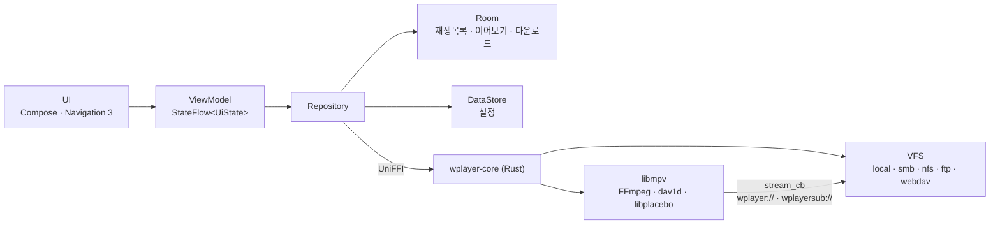

<div align="center">


# Wplayer

**파일 서버의 영상을 바로 재생하는 Android 태블릿·폰·TV용 동영상 플레이어**

[](https://github.com/rapidrabbit76/Wplayer/actions/workflows/ci.yml)


[](../../LICENSE)

[English](../../README.md) · 한국어

</div>

Wplayer는 SMB·NFS·FTP·WebDAV 공유 폴더와 기기 저장소를 탐색하고, 찾은 영상을 [libmpv](https://mpv.io)와
FFmpeg로 재생합니다. 하드웨어 디코딩이 안 되면 소프트웨어로 넘어가고, mpv가 읽는 자막 형식은 모두 지원하며,
큰 화면에 맞춘 제스처로 조작합니다. 네트워크 읽기·섬네일·다운로드는 Rust 코어가 맡아서, 탐색과 재생이 같은 연결 계층을 씁니다.

<p align="center">
  
</p>
<table>
  <tr>
    <td width="50%"></td>
    <td width="50%"></td>
  </tr>
  <tr>
    <td align="center"><sub>재생 화면 — 빠른 메뉴, 10초 이동, 탐색 막대 프레임 미리보기</sub></td>
    <td align="center"><sub>설정 — 넓은 화면에서는 항목과 옵션을 나란히 표시</sub></td>
  </tr>
</table>

## 한눈에 보기

| | |
|---|---|
| 🎞️ **코덱** | H.264 · HEVC · AV1 · VP9 등 하드웨어 디코딩, 칩이 못 하면 소프트웨어(AV1은 dav1d) |
| 🗄️ **소스** | 기기 저장소 · SMB 2/3 · NFSv3 · FTP/FTPS · WebDAV(S) |
| 👆 **제스처** | 밝기·볼륨·탐색 스와이프, 더블탭, 길게 눌러 배속, 자막 끌기·핀치 |
| 📶 **스트리밍** | 최대 300초 미리 읽기, 최대 10GB 디스크 캐시 |
| 🖼️ **섬네일** | 모든 프로토콜·코덱에서 동영상 섬네일, 탐색할 때 프레임 미리보기 |
| 🤖 **AI 자막** | 기기 안에서 음성을 인식(whisper.cpp)해 보는 동안 자막을 만듦 |
| ⬇️ **다운로드** | 서버의 파일을 기기에 받기, Wi-Fi 끊김·앱 재시작 후 이어받기 |
| 🎧 **백그라운드** | 화면을 끄고 소리만 재생, 헤드셋 버튼, 잠금 화면 조작 |
| 📺 **TV** | Android TV·Google TV 런처, 방향키로 모든 화면 조작, 리모컨으로 재생 조작 |
| 🌐 **언어** | 영어·한국어, 시스템 언어를 따르거나 설정에서 선택 |

## 기능

<details open>
<summary><b>재생 엔진</b></summary>

- **libmpv 0.41, FFmpeg 9.0.2, dav1d 1.5.4**를 [`native/build.sh`](../../native/build.sh)로 직접 빌드
- **하드웨어 디코딩**: H.264/HEVC/AV1/VP9/VP8/MPEG-2/MPEG-4를 MediaCodec(무복사 출력)으로 재생하고, 실패하면
  `mediacodec-copy`, 그다음 소프트웨어로. 칩에 없는 코덱은 자동으로 소프트웨어 재생. 하드웨어 디코더가 10초 안에
  첫 프레임을 내지 못하면 소프트웨어 엔진으로 바꿔 이어서 재생
- **출력**: `vo=gpu-next`(libplacebo). HDR은 SDR 화면에 맞게 톤 매핑
- **화질 향상**(설정 → 화면, 영상을 확대할 때만 동작): GPU 셰이더로 선명(AMD FSR 1) / 디테일(FSRCNNX x2) /
  애니(Anime4K 모드 A). 디밴딩, 화면 주사율에 맞춘 프레임 블렌딩(`display-resample` + `interpolation`)
- **AI 자막**(재생 중 자막 메뉴): whisper.cpp가 기기 안에서 음성을 받아써 SRT를 만들고, 지금 보는 위치부터 시작.
  별도 mpv가 오디오만 16 kHz로 풀고, Silero VAD로 말소리 구간에 타임스탬프를 맞춤. 모델(small 264 MB /
  large-v3-turbo 574 MB)은 설정 → 자막에서 Wi-Fi로 받고 SHA-256으로 확인. 영상이나 소리는 밖으로 보내지 않음
- **재생 정보 오버레이**(개발자 옵션): 코덱·디코더·드롭 프레임·비트레이트·캐시

</details>

<details open>
<summary><b>재생 조작</b></summary>

- 폴더·재생목록 단위 이전/다음, 자동 다음 재생, 반복(한 파일/전체)·무작위
- 이어보기(항상/안 함/물어보기), A-B 반복, 배속(유지 옵션), 음성 싱크, 볼륨 증폭(최대 200%)
- 화면 비율·맞춤/늘이기/채우기, 하드웨어 ↔ 소프트웨어 디코딩 전환, 화면 속 화면, 화면 잠금
- 탐색 막대를 끌거나 가로로 스와이프하면 **그 위치의 프레임**을 미리 보여 줌
- 재생 버튼 양옆 빠른 메뉴: 잠금 · 배속 · 화면 맞춤·비율 · 디코더
- ⚙ 버튼으로 재생·화면·자막·오디오·제스처 설정을 영상을 끄지 않고 변경
- **블루투스 리모컨·키보드**: ←/→ 짧게 = 이동, → 길게 = 다음 파일, ← 길게 = 처음으로(시작 근처면 이전 파일),
  Space·Enter·미디어 키 = 재생/정지, 밝기 키 = 플레이어 밝기
- **TV 리모컨**: ↑/↓·메뉴 키로 조작 버튼에 포커스, 방향키로 이동, 탐색 막대에서 ←/→로 탐색.
  패널은 열리면 포커스를 받고, 뒤로 키는 패널 닫기 → 조작 버튼 숨기기 → 재생 종료 순서

</details>

<details open>
<summary><b>제스처</b></summary>

| 동작 | 기능 |
|---|---|
| 왼쪽 / 오른쪽 세로 스와이프 | 밝기 / 볼륨 |
| 가로 스와이프 | 탐색 (프레임 미리보기) |
| 양옆 / 가운데 더블탭 | ±N초 이동 / 화면 속 화면(또는 재생·정지) |
| 길게 누르기 | 배속 재생 |
| 핀치 | 화면 확대 |
| 두 손가락 ↓ / ↔ | 화면 속 화면 / 자막 싱크 |
| 자막 위에서 끌기 · 핀치 · 좌우 | 자막 위치 · 크기 · 이전/다음 대사 |

</details>

<details open>
<summary><b>자막</b></summary>

- ASS/SRT/SMI, 같은 이름의 외부 자막 자동 로드, CP949 같은 옛 인코딩을 감지해 UTF-8로 변환
- 크기·위치·색·테두리·그림자·배경 상자·우선 언어 설정
- 플레이어 안 자막 패널(싱크·크기·위치)

</details>

<details open>
<summary><b>탐색 · 보관함</b></summary>

- 탭: 보관함 · 재생목록 · 다운로드 · 설정 (TV에서는 왼쪽 세로 막대)
- 보관함 첫 화면의 **이어서 보기**, 시청 진행 막대, 정렬·필터
- **잠금 폴더**: 폴더를 길게 눌러 잠그면 기기 인증(지문·얼굴·화면 잠금)으로만 열림. 앱을 나가면 다시 잠기고,
  안의 영상은 기록·검색 결과·섬네일 캐시에 남지 않음
- 한 번 연 폴더는 바로 표시하고 뒤에서 새로 고침
- 넓은 화면에서 **폴더 3단 보기**, 모든 목록에서 목록 ↔ 격자 보기, 섬네일 크기 조절
- **이름 검색**: 현재 폴더는 입력 즉시, 하위 폴더 포함 시 10단계·500개까지. 파일 이름 색인(Room)에서 바로 답하고
  뒤에서 갱신. 충전 중·Wi-Fi일 때 하루 한 번 미리 색인 가능
- 깊은 폴더를 위한 **경로 막대**와 **`..` 상위 폴더** 항목(둘 다 또는 하나만)
- 파일과 폴더를 담는 **재생목록**(폴더는 북마크처럼 바로 열림), 최근 재생 기록
- 테마: 기본 다크, 배경화면 색, 완전한 검정

</details>

<details open>
<summary><b>네트워크 · 다운로드 · 백그라운드</b></summary>

- **네트워크 캐시**: 미리 읽기(최대 300초) · 캐시 크기(최대 10GB, 메모리가 아닌 저장 공간) · 재개 대기 ·
  모바일 데이터 허용. 기기 저장소의 파일은 캐시하지 않음
- **섬네일**: 잠깐 띄운 mpv(`vo=image`)가 한 프레임을 JPEG로 저장하므로 모든 프로토콜·코덱에서 동작
- **다운로드**: WorkManager 작업과 진행 알림, `Download/Wplayer`에 저장, 네트워크 끊김·재시작 후 이어받기
- **백그라운드 재생**: Media3 `MediaSession`(mpv를 감싼 `SimpleBasePlayer`)과 `MediaSessionService`. 알림·잠금 화면 조작,
  헤드셋·블루투스 버튼, 오디오 포커스, 이어폰을 뽑으면 일시정지. 화면이 보이지 않을 때는 영상 디코딩을 멈춤

</details>

## 설치

[최신 릴리스](https://github.com/rapidrabbit76/Wplayer/releases/latest)에서 APK를 받아 기기에서 엽니다(브라우저나
파일 관리자에 "출처를 알 수 없는 앱 설치"를 허용). 앱은 GitHub에서 새 릴리스를 확인하고(시작할 때 12시간에 한 번,
또는 설정 → 업데이트), 받은 파일의 SHA-256을 검증한 뒤 시스템 설치 화면에 넘깁니다.

TV에는 처음 한 번 `adb install`이나 사이드로딩 앱으로 설치하면 그다음부터 같은 방식으로 업데이트됩니다.
APK 하나에 64비트 ARM(`arm64-v8a`)과 32비트 ARM(`armeabi-v7a`)이 들어 있습니다. 32비트는 시스템이 32비트인 TV용입니다.

### 서버 연결

| 프로토콜 | 경로 | 참고 |
|---|---|---|
| SMB | 비우면 공유 폴더 목록, 또는 `/공유폴더[/하위폴더]` | SMB 2/3(암호화 필수 포함), 포트 445. 게스트(익명) 접속은 아직 지원하지 않으니 계정으로 로그인 |
| NFS | 내보내기 경로 (`/volume1/video`) | 사용자 이름 칸에 `uid` 또는 `uid:gid`. 앱은 1024 미만 포트를 쓸 수 없으므로 서버에서 비특권 포트 연결 허용(insecure) 필요 |
| FTP / FTPS | 시작 폴더 | FTPS는 명시적 TLS(`AUTH TLS`). PASV 응답의 주소 대신 접속한 서버로 데이터 연결(NAT·컨테이너 대응) |
| WebDAV(S) | WebDAV 기본 경로 | Synology는 포트 5005/5006. 기본 인증서를 쓰는 서버는 "자체 서명 인증서 허용"을 켜세요 |

비밀번호는 Android Keystore(AES-GCM)로 암호화해 저장합니다.

## 빌드

필요한 것:

- JDK 21, Android SDK(플랫폼 37), NDK `30.0.16248370`
- Rust(stable)와 `cargo-ndk`, 타깃 `aarch64-linux-android`·`armv7-linux-androideabi`
- 네이티브 라이브러리용: `meson`, `ninja`, `cmake`, `nasm`, `pkg-config`, `git`, bindgen용 `libclang`

macOS(Homebrew): `brew install openjdk@21 android-commandlinetools meson ninja cmake nasm pkg-config`.
Ubuntu는 [CI 워크플로](../../.github/workflows/ci.yml)의 패키지를 참고하세요.

```sh
source ./env.sh                       # JAVA_HOME, ANDROID_HOME, ANDROID_NDK_HOME (환경에 맞게 수정하거나 미리 설정)
native/build.sh                       # 두 ABI용 libmpv·FFmpeg 등, 처음 한 번 몇 분 걸림
./gradlew :app:assembleDebug          # Rust 코어 크로스 컴파일과 Kotlin 바인딩 생성까지 자동
```

네이티브 라이브러리를 올리려면 [`native/versions.env`](../../native/versions.env)의 버전을 바꾸고 해당 항목을 다시
빌드합니다(`native/build.sh ffmpeg mpv`).

**릴리스 빌드**는 레포 루트의 `keystore.properties`(커밋하지 않음)에 적은 키로 서명합니다. 이 파일이 없으면 디버그
키로 서명되고, 그 APK로는 릴리스 키로 설치된 앱을 업데이트할 수 없습니다.

```properties
storeFile=/path/to/release.jks
storePassword=…
keyAlias=…
keyPassword=…
```

자체 릴리스를 내는 포크는 `gradle.properties`에 `wplayer.updateRepository=owner/repo`를 넣어 업데이트를 그 레포에서
찾게 합니다.

화면 코드를 크게 바꾼 뒤에는 Baseline Profile을 다시 만드세요(기기·에뮬레이터 필요, 약 5분). 앱 시작과 스크롤
경로를 미리 컴파일해 둡니다.

```sh
./gradlew :app:generateReleaseBaselineProfile   # → app/src/release/generated/baselineProfiles/
```

## 구조



```
app/              UI(Compose, Navigation 3, Material 3 Adaptive), ViewModel, Room/DataStore, Hilt, WorkManager, Media3
core/native/      Kotlin ↔ 네이티브 경계: 자동 생성된 UniFFI 바인딩, MpvEngine, Surface JNI
rust/             wplayer-core: 프로토콜(VFS), libmpv 브리지, 섬네일·프레임 미리보기, 다운로드, 자막 인코딩, 음성 인식
native/           libmpv·FFmpeg·dav1d·libass·libplacebo 빌드 스크립트(versions.env에 버전 고정)
baselineprofile/  Baseline Profile 생성(앱 시작·탐색·설정)
scripts/          릴리스 스크립트, 로컬 FTP/WebDAV/SMB/NFS 테스트 서버
```

- 화면은 단방향 데이터 흐름을 따릅니다. ViewModel이 `StateFlow<UiState>`를 내보내고 화면은 이벤트만 올립니다.
- 네트워크 파일은 Rust가 읽어 mpv의 `stream_cb`로 넘기므로 탐색과 재생이 같은 경로를 씁니다.

## 테스트

```sh
(cd rust && cargo test)                                    # Rust 단위 테스트
./gradlew :app:testDebugUnitTest :core:native:testDebugUnitTest :app:lintRelease
./gradlew :app:recordRoborazziDebug                        # 폰·태블릿 화면 캡처 → app/build/outputs/roborazzi
eval "$(scripts/test-servers.sh start)"                    # 로컬 FTP·WebDAV·SMB(Docker)·NFS 서버
(cd rust && cargo test -p wplayer-core --test live_sources -- --ignored)
scripts/test-servers.sh stop
```

Lint 경고가 있으면 빌드가 실패합니다. 꼭 필요할 때만 이유와 함께 [`app/lint.xml`](../../app/lint.xml)에서 끄세요.

<details>
<summary><b>에뮬레이터</b></summary>

```sh
avdmanager create avd -n wplayer_tablet -k "system-images;android-36;google_apis;arm64-v8a"
# config.ini: hw.lcd.width=2560, hw.lcd.height=1600, hw.lcd.density=280,
#             kernel.parameters=arm64.nosve arm64.nosme   ← 에뮬레이터가 SVE를 잘못 알려 dav1d가 SIGILL로 죽는 것 방지
$ANDROID_HOME/emulator/emulator -avd wplayer_tablet
```

- 에뮬레이터의 MediaCodec(goldfish)은 첫 프레임을 내지 않아 매번 10초 뒤 소프트웨어로 전환됩니다. 실기기에서는 생기지 않습니다.
- 에뮬레이터에서 호스트의 테스트 서버는 `10.0.2.2`로 접속합니다.
- TV: `avdmanager create avd -n wplayer_tv -k "system-images;android-34;google-tv;arm64-v8a" -d tv_1080p`.
  방향키는 `adb shell input keyevent DPAD_DOWN`, 길게 누르기는 `--longpress DPAD_CENTER`로 보냅니다.

</details>

## 릴리스

버전은 git 태그(`vX.Y.Z`)로 관리합니다. Gradle이 태그를 읽어 `versionName`과
`versionCode`(메이저 × 1,000,000 + 마이너 × 1,000 + 패치)를 정하고, 태그 사이의 빌드는 `0.2.0-3-gabc1234`처럼 표시됩니다.

```sh
scripts/release.sh            # 패치: 0.1.0 → 0.1.1
scripts/release.sh minor      # 0.1.1 → 0.2.0
scripts/release.sh --dry-run  # 빌드·검증만, push·게시 안 함
```

테스트와 lint를 돌리고, 서명된 APK를 빌드해 버전과 서명을 확인한 뒤, 태그를 push하고 APK와 `latest.json`(버전,
SHA-256, 지난 릴리스 이후 변경)을 GitHub 릴리스로 게시합니다. 앱 내 업데이트는 이 `latest.json`을 읽습니다.
로컬 설정은 `scripts/release.env`(커밋하지 않음)에 둡니다.

## 기여

버그 제보, 번역, 풀 리퀘스트 모두 환영합니다. [CONTRIBUTING.md](../../CONTRIBUTING.md)를 참고하세요.
보안 문제는 [SECURITY.md](../../SECURITY.md)에 적힌 대로 비공개로 알려 주세요.

## 라이선스

Wplayer는 [GNU General Public License v3.0 이상](../../LICENSE)을 따르는 자유 소프트웨어입니다. mpv를 GPL 기능까지
넣어 빌드하므로 앱 전체가 GPL이며, 버전 3을 택해 Apache-2.0인 AndroidX와도 함께 쓸 수 있습니다.

함께 들어가는 라이브러리와 라이선스는 [THIRD_PARTY_NOTICES.md](../../THIRD_PARTY_NOTICES.md)와 앱의 설정 → 정보에 있습니다.
앱의 목록은 AboutLibraries가 Gradle 의존성, `cargo metadata`, [`app/aboutlibraries/`](../../app/aboutlibraries)에서 모아 만듭니다.

Wplayer의 탐색과 제스처는 nPlayer에서 영감을 받았습니다. nPlayer와 코드를 공유하지 않으며 그 제작사와 관계가 없습니다.
